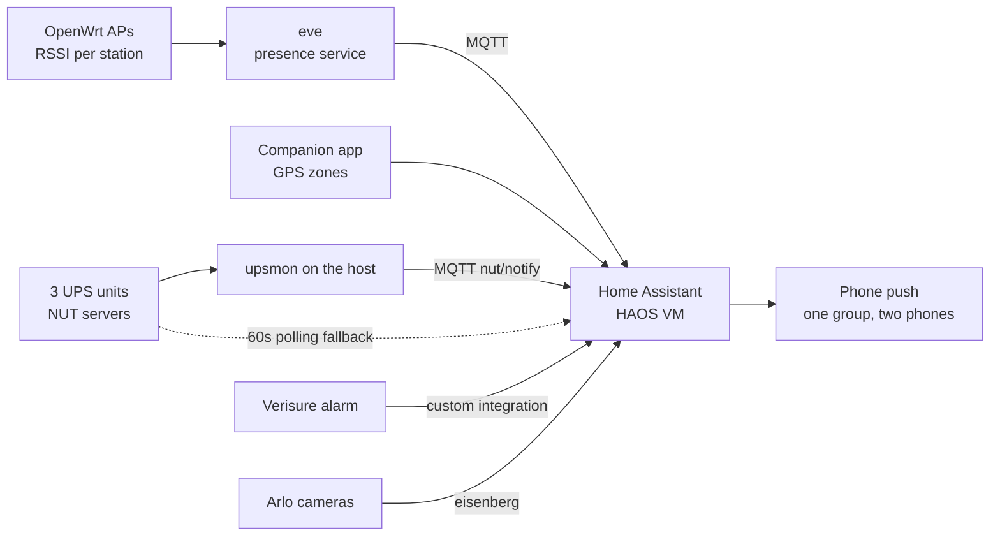

People on IRC keep asking me how my Home Assistant is set up, and someone
always wants to copy it. So here's all of it, starting from the hardware.

The order is deliberate. Automations are the visible part, but they sit on
a box that can die, a disk that can be stolen and a VM that can corrupt
itself during a backup. If those layers are wrong, it doesn't matter how
good the automations are.

## The box: one Raspberry Pi 5, encrypted

Everything runs on **nowhere**, a Raspberry Pi 5 with a 1 TB NVMe drive.
There's no rack and no Proxmox cluster. It's one Pi, and it also runs the
DNS resolver, the internal certificate authority, the metrics and logs
stack, the WiFi presence service, the UPS server, and the Claude Code
session that's helping me write this post.

The root filesystem is **LUKS-encrypted**. The firmware loads an initramfs
that asks for the passphrase. Since the Pi has no keyboard attached, the
initramfs also runs **dropbear**, so I can SSH in and unlock it remotely
after a power cut. I wrote up the setup step by step in
[Raspberry PI 5 encrypted root with LUKS](/posts/2026-01-20-raspberry-pi-luks-encrypted-root/).

```
nvme0n1          953.9G
├─nvme0n1p1      512M   vfat         /boot/firmware
└─nvme0n1p2      953.4G crypto_LUKS
  └─cryptroot    953.3G ext4         /
```

This matters for Home Assistant because **HAOS has no full-disk encryption
option**. HA's database holds a complete history of who was home and when,
when the alarm was armed and every door event. On bare-metal HAOS, anyone
who walks off with the SSD walks off with all of that. Inside a LUKS volume
it's just more ciphertext.

That's the main reason HA is a VM and not the operating system.

## The VM: HAOS under libvirt/KVM

The Pi 5 has hardware virtualization, and KVM on aarch64 works fine. HAOS
ships a generic aarch64 qcow2 image, and libvirt boots it like any other
guest:

- **2 vCPU, 2 GB RAM**, `host-passthrough` CPU. That's plenty for 300-odd
  entities and two dozen automations.
- **UEFI with Secure Boot** (AAVMF firmware with the Microsoft keys
  enrolled), because HAOS boots via EFI anyway, and I see no reason to run
  it with Secure Boot off.
- **qcow2 disk on virtio**, a file under `/srv/haos/` on the encrypted
  root. That one file is the whole of Home Assistant, which makes backing
  it up much easier (see below).
- **virtio NIC bridged onto the LAN** (`br-lan`). HA gets its own address
  on the home network, so mDNS, SSDP and device discovery work as if it
  were a physical box. NAT would have broken half of discovery.
- **A USB Bluetooth dongle passed through** to the guest, because HA's
  Bluetooth integrations want a real adapter. The toothbrush reports how
  long you brushed, and of course it goes into Home Assistant.
- **A virtio-serial channel for the QEMU guest agent.** That single line in
  the domain XML is what makes consistent backups possible. HAOS ships the
  guest agent, so all I had to do was add the channel.

I run HA as a VM and not as a container on the host because HAOS is the
supported configuration. With HAOS you get the supervisor, the add-ons and
one-click updates. The "container" install is officially supported too,
but it drops the supervisor and add-ons, and then I'd have to run
Mosquitto and the Matter server myself. A VM gives me the full appliance
experience with my own disk encryption underneath.

## Backups, layer one: the whole box, every night

`systemd` runs the backup at 02:00, with up to 15 minutes of random delay.
It runs [restic](https://restic.net/) against a repository on the Synology
NAS (**wolfgang**), mounted over NFS. Restic encrypts the data and the NAS
share doesn't. The threat model is someone stealing the NAS, and the restic
password exists only on the Pi (plus one copy in a place I won't name
here).

Backing up the whole filesystem is easy. The hard part is the running VM,
because a qcow2 copied while the guest writes to it is a coin toss: half
the blocks from before a write and half from after. SQLite in particular
doesn't forgive that.

The fix is a **quiesced, external, disk-only snapshot**:

```bash
virsh snapshot-create-as --domain haos backup-snapshot \
  --diskspec vda,file=/srv/haos/haos.qcow2.snap \
  --disk-only --quiesce --no-metadata
```

In order, this is what happens:

1. libvirt asks the **guest agent** inside HAOS to freeze the filesystems
   (`fsfreeze`). The guest flushes its dirty pages to disk and holds new
   writes, so the on-disk image is consistent.
2. libvirt creates an **overlay** (`haos.qcow2.snap`) and switches the VM's
   writes to it. The original `haos.qcow2` becomes read-only.
3. The guest is **thawed**. It was frozen for a fraction of a second, and
   HA doesn't notice.

Restic then backs up `haos.qcow2` without hurrying, since nothing is
writing to it anymore. When the backup finishes, the overlay gets merged
back:

```bash
virsh blockcommit haos vda --active --pivot --wait
```

`--active` commits from the live top layer, `--pivot` switches the VM back
onto the base image once the merge is done, and `--wait` blocks until it
has. The overlay is then deleted.

The full nightly sequence:

1. **Check the previous run.** If the VM is still running on a `.snap`
   overlay, the last backup died halfway. Blockcommit first. If that fails
   too, the script stops and yells at me. I don't stack a second overlay on
   top of a half-broken one.
2. **Quiesced snapshot** of the HAOS disk.
3. **Flush VictoriaMetrics and VictoriaLogs**, so their in-memory buffers
   are on disk before restic reads them.
4. **`docker image prune -a`**: every container rebuilds from its
   Dockerfile, so there's no reason to back up gigabytes of image layers.
5. **`restic backup`** of the whole filesystem.
6. **`restic forget --prune`**: keep 7 daily, 4 weekly and 6 monthly.
7. **Blockcommit** the VM back onto its base disk.

The echo lines in the script are full of Italian blasphemy. It's the
emotional state of whoever wrote it, kept on purpose.

### Disaster recovery

A backup you can't restore doesn't count. The same repo builds a
**recovery SD image** with `debootstrap`, and that image lives on the NAS
next to the restic repository. If the NVMe dies:

1. Flash the image to an SD card and boot the Pi from it.
2. Run `restore`. It's an interactive wizard that mounts the NAS, lists the
   restic snapshots, partitions the new SSD, sets up LUKS and restores.
3. Pull the SD and reboot from the SSD.

HA comes back together with everything else, because it's just a qcow2
file in the snapshot.

## Backups, layer two: Home Assistant's own

HA also takes its own **native backups**, daily, keeping 30 copies, both
locally and on the NAS through the Synology integration. They're
**encrypted** (SecureTar, with a key HA generates and you have to store
somewhere) and include the database.

Two layers isn't paranoia. They serve different purposes:

- **The VM image** restores the *whole system* exactly as it was: OS,
  add-ons, everything. It's the one you use when the disk dies.
- **HA backups** let you pull out *one thing*: the config, an add-on, or
  the database from three weeks ago.

The second one paid off today. I was analysing a washing machine's usage
(more on that below), and HA's recorder had been sitting at its default
**10-day** retention. Ten days isn't enough to learn anyone's habits. The
older data was still in the nightly HA backups, though. I decrypted three
of them, pulled the recorder database out of each, merged them, and ended
up with **five weeks** of history instead of ten days. Then I raised the
recorder retention to a year, so I won't need to do that again.

## What feeds Home Assistant

HA doesn't do everything itself. Several things around it push data in.



### Presence: GPS and WiFi, and only one of them can open the door

There are two sources:

- **GPS**, from the HA Companion app on our phones. It's zone-based, so
  "home" or "not home".
- **WiFi**, from a service I wrote
  ([openwrt-ha-presence](https://github.com/vjt/openwrt-ha-presence)) that
  reads each station's RSSI straight from the OpenWrt access points. The
  strongest AP decides the room. It's room-level presence with no BLE
  beacons and no cloud. I covered the details in
  [WiFi Presence Detection for Home Assistant Using OpenWrt](/posts/2026-02-15-wifi-presence-detection-home-assistant/).

On top of these I built a few template sensors: *residents home*, *anyone
home* (residents plus people who aren't residents but come and go), and
*residents in bed*, which uses the room-level WiFi data.

The rule that took the longest to get right is about trust. **WiFi can arm
the alarm. It can never disarm it on arrival.** Anyone who associates to an
access point with the right MAC "arrives" according to WiFi, and MAC
addresses are trivial to spoof. GPS from a phone logged into the HA app is
much harder to fake. So when someone leaves, either source can say the
house is empty, and that arms the alarm, which is the safe direction to be
wrong. Arriving home needs GPS.

### UPS: three units, three paths

There are three UPS units: one for the Pi and the gateway, one for the NAS
and the TV, and one for my workstation. That last one is plugged into
**pingu**, which runs NUT on OpenWrt. Each UPS has a NUT server, and three
different consumers read from them:

- **`upsmon` on the host** watches all three and runs a small script on
  every event (on battery, back on line, low battery) that publishes to
  MQTT `nut/notify`. HA picks it up and sends a push **instantly**.

That's the part that matters most: **when the power goes, my phone gets a
critical notification**, the kind that rings through silent mode and Do
Not Disturb. A blackout at 3 AM is exactly when you want to be woken up,
because the UPS clock is already running.
- **HA's NUT integration** polls each UPS every 60 seconds. That's the
  fallback for when MQTT or the host-side script is the thing that broke.
- **Telegraf** scrapes all three every 10 seconds into VictoriaMetrics, for
  dashboards and long-term graphs.

The notification texts are all in Italian, and they're mapped from NUT's
event types, so we get "a batteria" and not `ONBATT`.

## The alarm

The alarm is a Verisure system. The official app is slow, full of ads and
can't be automated, so I replaced it with a custom integration
([ha-verisure-italy](https://github.com/vjt/ha-verisure-italy)), written up
in [How I replaced the Verisure app with Home Assistant](/posts/2026-04-04-verisure-italy-home-assistant/).
With the integration in place, the automations do the work.

I'm deliberately not publishing the exact conditions here: this is the
alarm of a house where people live. Here's the shape of it:

- **Last one out arms it.** When the house goes empty, a script arms in
  *away* mode and **checks that the arm went through**. If it didn't, a
  critical push goes out.
- **Safety net.** Every five minutes, and every time the alarm goes to
  *disarmed*: if the house is empty and the alarm is off, arm it and send a
  critical notification. This exists because the primary automation will
  miss eventually, and the safety net catches it when it does.
- **Open windows.** If an away-arm fails because of an open zone, HA tells
  us which window and then **force-arms** (the integration exposes that).
  If the night arm fails, it does *not* force anything: we're home, so
  someone gets up and closes the window.
- **Night mode** turns on when both of us are actually in the bedroom, and
  room-level WiFi presence is what makes that possible.
- **Arriving home**: you get an actionable notification with a "Disattiva"
  button.
- **The alarm itself breaking**: if the integration reports a state code it
  doesn't recognize, or the entity stays unavailable for five minutes, a
  critical push goes out. A broken alarm
  integration means the automations stop silently, and silence is the
  worst way for a security system to fail.

There's also a **kill switch**: one switch turns every alarm automation
off. It gets used before any risky change, for a reason I explain at the
end.

Cameras follow the alarm. The Arlo outdoor camera (via
[Eisenberg](/posts/2026-04-28-eisenberg-arlo-on-home-assistant/), my Arlo
integration) and Synology Surveillance Station on the NAS record when the
house is armed away and go quiet when we're home. Nobody wants a camera
recording their own living room.

All notifications go to one **notify group** that fans out to both phones,
so there's one call per message, the texts are in Italian, and nothing ends
up on only one phone because someone forgot to copy a line.


## Peppina: the washing machine that nags

This is the part people on IRC ask about most.


Peppina is our washing machine, on Haier's hOn cloud. The official hOn
app is a steaming pile of garbage 🤬🤬🤬 and it can't automate
anything. So it lives in Home Assistant now. The
community [hon](https://github.com/gvigroux/hon) integration reads it fine,
but it can't **stop** a program or schedule a **delayed start** that HA
owns. So I wrote [Peppina](https://github.com/vjt/peppina): program
selector, start and stop buttons, and a delayed start that HA schedules
itself and that survives a restart. It started as an add-on riding hon's
connection; since version 0.3.0 it talks to the hOn cloud with its own
small client, logs in by itself, and hon is gone.

Here it is starting a drum-clean cycle from Home Assistant, nobody
touching the panel:

<video controls muted playsinline preload="metadata" width="100%">
  <source src="/posts/2026-10-10-home-assistant-from-the-metal-up/peppina-start.mp4" type="video/mp4">
</video>

And this is how the official app ended:


The integration didn't solve the actual problem, which is a human one. You
load the machine, enable remote control on the panel so HA can start it,
and then forget to start it. The next morning the laundry is still in the drum,
dirty, never washed.

So first I looked at the data: five weeks of history, the ones I'd
recovered from the backups. When does the machine get loaded, and when
does the cycle start? I cross-referenced that with when our housekeeper
is in the house. From there the rules were easy
to write:

- **Loaded in the afternoon or evening**: schedule it to **finish at 09:00
  the next morning**, so it doesn't sit wet overnight. If the housekeeper is
  home in the afternoon, start it right away instead.
- **Loaded in the morning with her home**: start it now, since she'll be
  there to hang it out.
- **Loaded in the morning without her**: finish at 13:30.
- A delayed start set **by hand** is never overridden.

Then there are three guards around that:

1. **Start watchdog.** Five minutes after the planned start, if the machine
   isn't washing (door open, hOn refusing, HA down at the wrong moment), I
   get a critical push. I measured the delay: from scheduled start to the
   machine reporting "washing" takes about 46 seconds.
2. **Remote control switched off** before the delayed start: the pending
   start gets cancelled, because otherwise it would just fail.
3. **The nag.** When the cycle ends, a "da stendere" (needs hanging) flag
   turns on, and **every hour from 07:00 to 23:00, wherever I am**, I get a
   push with a "Stesa" (hung) button, plus one **the moment I walk in
   the door**, because that's when I can actually do something about
   it. It stops when someone taps the
   button, or when the machine is switched on again after five minutes
   off. hOn drops off the network for about a minute at a time, and the
   five minutes keep those blips from counting.


The nag first only ran while I was home. That turned out to be pointless:
I'm not home, the wet laundry is, and it's still going sour. Now it runs
everywhere, hourly instead of every fifteen minutes.

On top of that it has a dashboard: one full-page card with the machine
drawn in SVG. The drum turns while it washes and the whole thing shakes on
the spin cycle. It's useless, and it's my favourite thing in the house.


And here it is washing, on the phone:

<video autoplay loop muted playsinline width="50%">
  <source src="/posts/2026-10-10-home-assistant-from-the-metal-up/peppina-dashboard.mp4" type="video/mp4">
</video>

The dishwasher (Filippa, via Home Connect) can be started from HA too.
It doesn't nag yet.

## The rest of it

Without much commentary: **tado** for heating, **Sonos**, a **Reolink**
camera, the **LG TV** with Wake-on-LAN (the webOS integration can't turn
the TV on, so a WoL packet does it), **SwitchBot**, **Matter/Thread**
devices through the Matter server add-on, **Mosquitto** as the MQTT
broker, a phone-battery alert for each of us, and the **Oral-B**
toothbrush, which I mentioned above and still won't defend.

## How it's managed: git, YAML, and Claude

The whole HA config lives in a **private git repository**. Automations are
YAML files split by domain (`alarm.yaml`, `ups.yaml`, `peppina.yaml`…).
The UI's own `automations.yaml` stays empty, and HA doesn't touch the
directory I manage.

The workflow:

- `pull.sh` copies the config off HAOS (tar over SSH) to catch anything
  changed from the UI.
- I edit the files, or more often Claude Code edits them while I tell it
  what I want.
- `push.sh` sends them back, then I reload the domain I changed, and I
  restart HA only when a change really needs it.

There are a few rules. **Never round-trip HA's YAML through PyYAML**,
because it eats the Jinja templates. `.storage/` is read-only reference
and never gets pushed back. And there's a rule written in blood, from
today.

### The day the alarm armed itself with everyone home

This afternoon I changed the presence templates and reloaded them. A
template reload **recreates the entities**: for a split second presence
read *off*, the "last one out" automation fired, and the alarm armed in
away mode with both of us in the house.

The fixes: a few seconds of debounce on "house is empty", *unavailable*
instead of *off* while the inputs aren't ready, and a rule now written in
the repo's `CLAUDE.md`: **kill switch off before reloading templates**.
Sensors lie; one transition must never decide something irreversible.

## Pieces you can take

Most of this is mine and published:

- [openwrt-ha-presence](https://github.com/vjt/openwrt-ha-presence):
  room-level WiFi presence from OpenWrt APs
- [ha-verisure-italy](https://github.com/vjt/ha-verisure-italy): Verisure
  Italy alarm integration
- [ha-eisenberg](https://github.com/vjt/ha-eisenberg): Arlo cameras
- [peppina](https://github.com/vjt/peppina): hOn washing machine controls
  and the dancing dashboard

The backup scripts and the HA config itself stay private, because they
describe my house. But this post covers what they do, and the snapshot
dance above is the part worth copying.
