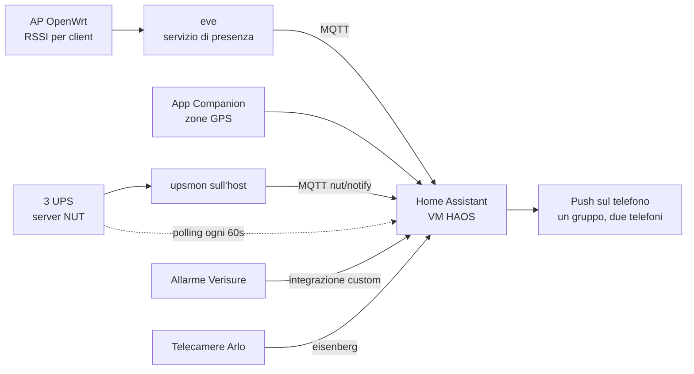

Su IRC mi chiedono spesso com'è fatto il mio Home Assistant, e c'è sempre
qualcuno che lo vuole copiare. Quindi eccolo tutto, partendo
dall'hardware.

L'ordine è voluto. Le automazioni sono la parte che si vede, ma stanno
sopra una macchina che può morire, un disco che possono rubarti e una VM
che si può corrompere durante un backup. Se questi strati sono sbagliati,
non importa quanto siano belle le automazioni.

## La macchina: un Raspberry Pi 5, cifrato

Gira tutto su **nowhere**, un Raspberry Pi 5 con un NVMe da 1 TB. Niente
rack, niente cluster Proxmox. È un solo Pi, che fa girare anche il resolver
DNS, la certification authority interna, lo stack di metriche e log, il
servizio di presenza WiFi, il server degli UPS, e la sessione di Claude
Code che mi sta aiutando a scrivere questo post.

Il filesystem di root è **cifrato con LUKS**. Il firmware carica un
initramfs che chiede la passphrase. Siccome il Pi non ha una tastiera
attaccata, nell'initramfs gira anche **dropbear**, così dopo un blackout
entro in SSH e lo sblocco da remoto. Ho raccontato il setup passo passo in
[Raspberry PI 5 encrypted root with LUKS](/it/posts/2026-01-20-raspberry-pi-luks-encrypted-root/).

```
nvme0n1          953.9G
├─nvme0n1p1      512M   vfat         /boot/firmware
└─nvme0n1p2      953.4G crypto_LUKS
  └─cryptroot    953.3G ext4         /
```

Per Home Assistant questo conta perché **HAOS non ha un'opzione di
cifratura del disco**. Il database di HA contiene la storia completa di
chi era in casa e quando, di quando era inserito l'allarme e di ogni
evento delle porte. Con HAOS su bare metal, chi si porta via l'SSD si
porta via tutto questo. Dentro un volume LUKS è solo altro testo cifrato.

È il motivo principale per cui HA è una VM e non il sistema operativo.

## La VM: HAOS sotto libvirt/KVM

Il Pi 5 ha la virtualizzazione hardware, e KVM su aarch64 funziona bene.
HAOS distribuisce un'immagine qcow2 generica per aarch64, e libvirt la
avvia come qualsiasi altro guest:

- **2 vCPU, 2 GB di RAM**, CPU `host-passthrough`. Bastano e avanzano per
  trecento entità e una ventina di automazioni.
- **UEFI con Secure Boot** (firmware AAVMF con le chiavi Microsoft
  caricate), perché HAOS fa comunque boot via EFI, e non vedo motivo di
  farlo girare col Secure Boot spento.
- **Disco qcow2 su virtio**, un file sotto `/srv/haos/` sulla root
  cifrata. Quel solo file è tutto Home Assistant, e questo rende il backup
  molto più semplice (vedi sotto).
- **Scheda di rete virtio in bridge sulla LAN** (`br-lan`). HA ha il suo
  indirizzo sulla rete di casa, così mDNS, SSDP e la discovery dei
  dispositivi funzionano come se fosse una macchina fisica. Col NAT metà
  della discovery sarebbe morta.
- **Una chiavetta Bluetooth USB passata** al guest, perché le integrazioni
  Bluetooth di HA vogliono un adattatore vero. Lo spazzolino ti dice per
  quanto tempo ti sei lavato i denti, e ovviamente finisce in Home
  Assistant.
- **Un canale virtio-serial per il QEMU guest agent.** È quella riga
  nell'XML del dominio che rende possibili i backup coerenti. HAOS il guest
  agent ce l'ha già, a me è bastato aggiungere il canale.

HA gira in una VM e non in un container sull'host perché HAOS è la
configurazione supportata. Con HAOS hai il supervisor, gli add-on e gli
aggiornamenti con un clic. Anche l'installazione "container" è supportata
ufficialmente, ma perdi supervisor e add-on, e poi Mosquitto e il Matter
server li dovrei far girare io. Con una VM ho l'appliance completa, con
sotto la mia cifratura del disco.

## Backup, primo strato: tutta la macchina, ogni notte

`systemd` lancia il backup alle 02:00, con fino a 15 minuti di ritardo
casuale. Gira [restic](https://restic.net/) verso un repository sul NAS
Synology (**wolfgang**), montato in NFS. Restic cifra i dati e lo share
del NAS no. Il modello di minaccia è che qualcuno si porti via il NAS, e la
password di restic esiste solo sul Pi (più una copia in un posto che qui
non dico).

Fare il backup di tutto il filesystem è facile. Il problema è la VM
accesa, perché un qcow2 copiato mentre il guest ci scrive sopra è un
terno al lotto: metà dei blocchi di prima di una scrittura e metà di dopo.
SQLite, in particolare, non perdona.

La soluzione è una **snapshot esterna, solo disco, con quiescenza**:

```bash
virsh snapshot-create-as --domain haos backup-snapshot \
  --diskspec vda,file=/srv/haos/haos.qcow2.snap \
  --disk-only --quiesce --no-metadata
```

In ordine, succede questo:

1. libvirt chiede al **guest agent** dentro HAOS di congelare i filesystem
   (`fsfreeze`). Il guest scrive su disco le pagine sporche e blocca le
   nuove scritture, così l'immagine su disco è coerente.
2. libvirt crea un **overlay** (`haos.qcow2.snap`) e ci sposta sopra le
   scritture della VM. Il `haos.qcow2` originale diventa di sola lettura.
3. Il guest viene **scongelato**. È rimasto fermo una frazione di secondo,
   e HA non se ne accorge.

Poi restic si fa il backup di `haos.qcow2` con calma, tanto non ci scrive
più nessuno. Finito il backup, l'overlay viene riassorbito:

```bash
virsh blockcommit haos vda --active --pivot --wait
```

`--active` fa il commit dallo strato in uso, `--pivot` riporta la VM
sull'immagine di base quando il merge è finito, e `--wait` aspetta che
abbia finito. Poi l'overlay viene cancellato.

La sequenza notturna completa:

1. **Controlla il giro precedente.** Se la VM gira ancora su un overlay
   `.snap`, l'ultimo backup è morto a metà. Prima blockcommit. Se fallisce
   anche quello, lo script si ferma e mi urla contro. Non impilo un
   secondo overlay sopra uno mezzo rotto.
2. **Snapshot con quiescenza** del disco di HAOS.
3. **Flush di VictoriaMetrics e VictoriaLogs**, così i loro buffer in
   memoria sono su disco prima che restic li legga.
4. **`docker image prune -a`**: ogni container si ricostruisce dal suo
   Dockerfile, quindi non c'è motivo di salvare gigabyte di layer.
5. **`restic backup`** di tutto il filesystem.
6. **`restic forget --prune`**: tieni 7 giornalieri, 4 settimanali e 6
   mensili.
7. **Blockcommit** della VM sul disco di base.

Gli echo dello script sono pieni di bestemmie. Sono lo stato d'animo di
chi l'ha scritto, e sono rimaste apposta.

### Disaster recovery

Un backup che non sai ripristinare non conta. Lo stesso repo costruisce
un'**immagine SD di recovery** con `debootstrap`, che sta sul NAS accanto
al repository restic. Se muore l'NVMe:

1. Scrivi l'immagine su una SD e fai partire il Pi da lì.
2. Lanci `restore`. È un wizard interattivo che monta il NAS, elenca le
   snapshot di restic, partiziona il nuovo SSD, prepara LUKS e ripristina.
3. Togli la SD e riavvii dall'SSD.

HA torna insieme a tutto il resto, perché nella snapshot è solo un file
qcow2.

## Backup, secondo strato: quelli di Home Assistant

HA fa anche i suoi **backup nativi**, ogni giorno, tenendone 30 copie, sia
in locale che sul NAS tramite l'integrazione Synology. Sono **cifrati**
(SecureTar, con una chiave che genera HA e che devi conservare da qualche
parte) e includono il database.

Due strati non sono paranoia. Servono a cose diverse:

- **L'immagine della VM** ripristina *tutto il sistema* com'era: OS,
  add-on, tutto. È quella che usi quando muore il disco.
- **I backup di HA** ti fanno tirare fuori *una cosa sola*: la config, un
  add-on, o il database di tre settimane fa.

Il secondo oggi è servito. Stavo analizzando l'uso della lavatrice (ci
arrivo sotto), e il recorder di HA era rimasto sulla ritenzione di
default di **10 giorni**. Dieci giorni non bastano per capire le abitudini
di nessuno. I dati più vecchi però erano ancora nei backup notturni di HA.
Ne ho decifrati tre, ho tirato fuori da ognuno il database del recorder,
li ho fusi, e mi sono ritrovato **cinque settimane** di storia invece di
dieci giorni. Poi ho portato la ritenzione del recorder a un anno, così
non devo rifarlo.

## Cosa entra in Home Assistant

HA non fa tutto da solo. Diverse cose intorno gli spingono dentro i dati.



### Presenza: GPS e WiFi, e solo uno dei due apre la porta

Le fonti sono due:

- **GPS**, dall'app Companion di HA sui nostri telefoni. Funziona a zone,
  quindi "a casa" o "fuori".
- **WiFi**, da un servizio che ho scritto
  ([openwrt-ha-presence](https://github.com/vjt/openwrt-ha-presence)) che
  legge l'RSSI di ogni client direttamente dagli access point OpenWrt.
  L'AP col segnale più forte decide la stanza. È presenza per stanza
  senza beacon BLE e senza cloud. I dettagli sono in
  [WiFi Presence Detection for Home Assistant Using OpenWrt](/it/posts/2026-02-15-wifi-presence-detection-home-assistant/).

Sopra ci ho costruito qualche sensore template: *residenti in casa*,
*qualcuno in casa* (i residenti più chi non abita qui ma va e viene), e
*residenti a letto*, che usa i dati WiFi per stanza.

La regola che mi ha richiesto più tempo riguarda la fiducia. **Il WiFi può
inserire l'allarme. Non può mai disinserirlo all'arrivo.** Chiunque si
associ a un access point col MAC giusto per il WiFi "è arrivato", e un
MAC si falsifica in due secondi. Il GPS di un telefono loggato nell'app di
HA è molto più difficile da falsificare. Quindi quando si esce basta una
qualsiasi delle due fonti a dire che la casa è vuota, e questo inserisce
l'allarme, che è il verso giusto in cui sbagliare. Per l'arrivo serve il
GPS.

### UPS: tre unità, tre strade

Gli UPS sono tre: uno per il Pi e il gateway, uno per il NAS e la TV, e
uno per la mia workstation. Quest'ultimo è collegato a **pingu**, che fa
girare NUT su OpenWrt. Ogni UPS ha un server NUT, e da quelli leggono tre
consumatori diversi:

- **`upsmon` sull'host** li sorveglia tutti e tre, e a ogni evento (a
  batteria, corrente tornata, batteria scarica) lancia uno scriptino che
  pubblica su MQTT `nut/notify`. HA lo raccoglie e manda un push
  **subito**.

Ed è la parte che conta di più: **quando salta la corrente, sul telefono
mi arriva una notifica critica**, quella che suona anche col silenzioso e
col Non disturbare. Un blackout alle 3 di notte è proprio quando vuoi
essere svegliato, perché il conto alla rovescia dell'UPS è già partito.
- **L'integrazione NUT di HA** interroga ogni UPS ogni 60 secondi. È il
  ripiego per quando a rompersi è MQTT o lo script lato host.
- **Telegraf** li legge tutti e tre ogni 10 secondi e li mette in
  VictoriaMetrics, per dashboard e grafici di lungo periodo.

I testi delle notifiche sono tutti in italiano, mappati dai tipi di
evento di NUT, quindi arriva "a batteria" e non `ONBATT`.

## L'allarme

L'allarme è un Verisure. L'app ufficiale è lenta, piena di pubblicità e
non si automatizza, quindi l'ho sostituita con un'integrazione custom
([ha-verisure-italy](https://github.com/vjt/ha-verisure-italy)), raccontata
in [How I replaced the Verisure app with Home Assistant](/it/posts/2026-04-04-verisure-italy-home-assistant/).
Con l'integrazione al suo posto, il lavoro lo fanno le automazioni.

Le condizioni esatte qui apposta non le pubblico: è l'allarme di una casa
dove vive gente. La forma è questa:

- **L'ultimo che esce lo inserisce.** Quando la casa si svuota, uno script
  inserisce in modalità *totale* e **controlla che l'inserimento sia
  andato a buon fine**. Se no, parte un push critico.
- **Rete di sicurezza.** Ogni cinque minuti, e ogni volta che l'allarme
  passa a *disinserito*: se la casa è vuota e l'allarme è spento, lo
  inserisce e manda una notifica critica. Esiste perché prima o poi
  l'automazione principale manca un colpo, e la rete di sicurezza lo
  prende.
- **Finestre aperte.** Se l'inserimento totale fallisce per una zona
  aperta, HA ci dice quale finestra e poi **forza l'inserimento**
  (l'integrazione lo permette). Se fallisce quello notturno *non* forza
  niente: siamo in casa, qualcuno si alza e chiude la finestra.
- **La modalità notte** si inserisce quando siamo davvero tutti e due in
  camera da letto, ed è la presenza WiFi per stanza che lo rende possibile.
- **Al rientro** ti arriva una notifica con un pulsante "Disattiva".
- **Quando si rompe l'allarme stesso**: se l'integrazione riceve un codice
  di stato che non conosce, o l'entità resta non disponibile per cinque
  minuti, parte un push critico. Un'integrazione dell'allarme rotta vuol
  dire automazioni che smettono in silenzio, e il silenzio è il modo
  peggiore in cui un sistema di sicurezza possa guastarsi.

C'è anche un **kill switch**: un interruttore che spegne tutte le
automazioni dell'allarme. Si usa prima di ogni modifica rischiosa, per un
motivo che spiego in fondo.

Le telecamere seguono l'allarme. La Arlo esterna (via
[Eisenberg](/it/posts/2026-04-28-eisenberg-arlo-on-home-assistant/), la mia
integrazione Arlo) e Surveillance Station sul NAS registrano quando la
casa è inserita in totale, e stanno zitte quando siamo in casa. Nessuno
vuole una telecamera che gli registra il salotto.

Tutte le notifiche vanno a un **gruppo notify** che le smista su entrambi
i telefoni, così c'è una sola chiamata per messaggio, i testi sono in
italiano, e niente arriva a un telefono solo perché qualcuno si è
dimenticato di copiare una riga.


## Peppina: la lavatrice che rompe le palle

È la parte su cui su IRC mi fanno più domande.


Peppina è la nostra lavatrice, sul cloud hOn di Haier. L'app ufficiale
hOn fa schifo al cazzo 🤬🤬🤬 e di automazioni non ha mai sentito
parlare. Quindi adesso vive in Home
Assistant. L'integrazione della community
[hon](https://github.com/gvigroux/hon) la legge bene, ma
non sa **fermare** un programma né fare un **avvio ritardato** gestito da
HA. Quindi ho scritto [Peppina](https://github.com/vjt/peppina): scelta
del programma, pulsanti di avvio e stop, e un avvio ritardato che
pianifica HA stesso e che sopravvive a un riavvio. È nata come aggiunta
che cavalcava la connessione di hon; dalla versione 0.3.0 parla col cloud
hOn con un client suo, fa il login da sola, e hon è sparita.

Eccola che parte con un ciclo di pulizia del cestello lanciato da Home
Assistant, senza che nessuno tocchi il pannello:

<video controls muted playsinline preload="metadata" width="100%">
  <source src="/posts/2026-10-10-home-assistant-from-the-metal-up/peppina-start.mp4" type="video/mp4">
</video>

E così è finita l'app ufficiale:


L'integrazione però non risolveva il problema vero, che è umano. Carichi
la lavatrice, attivi il controllo remoto sul pannello perché HA possa
avviarla, e poi ti dimentichi di avviarla. La mattina dopo trovi i panni
ancora sporchi nel cestello, mai lavati.

Quindi prima ho guardato i dati: cinque settimane di storia, quelle
recuperate dai backup. Quando viene caricata la lavatrice, e quando parte
il ciclo? Ho incrociato tutto con le ore in cui la nostra collaboratrice
domestica è in casa. Da lì le regole si scrivevano da sole:

- **Caricata di pomeriggio o di sera**: programmala per **finire alle
  09:00 della mattina dopo**, così non resta bagnata tutta la notte. Se
  la collaboratrice è in casa nel pomeriggio, invece, parte subito.
- **Caricata la mattina con lei in casa**: parte subito, tanto c'è lei a
  stendere.
- **Caricata la mattina senza di lei**: finisce alle 13:30.
- Un avvio ritardato impostato **a mano** non viene mai sovrascritto.

Intorno ci sono tre guardie:

1. **Watchdog dell'avvio.** Cinque minuti dopo l'avvio previsto, se la
   lavatrice non sta lavando (oblò aperto, hOn che rifiuta, HA giù nel
   momento sbagliato), mi arriva un push critico. Il ritardo l'ho
   misurato: dall'avvio programmato a quando la macchina dice "sto
   lavando" passano circa 46 secondi.
2. **Controllo remoto spento** prima dell'avvio ritardato: l'avvio in
   sospeso viene annullato, perché tanto fallirebbe.
3. **Il tormento.** Quando il ciclo finisce si accende un flag "da
   stendere", e **ogni ora dalle 07:00 alle 23:00, ovunque io sia**, mi
   arriva un push con un pulsante "Stesa", più uno **appena rientro a
   casa**, che è il momento in cui posso davvero farci qualcosa. Smette
   quando qualcuno preme il
   pulsante, o quando la lavatrice viene riaccesa dopo almeno cinque
   minuti spenta. hOn sparisce dalla rete per circa un minuto alla volta,
   e i cinque minuti servono a non contare quei buchi.


All'inizio il tormento partiva solo se ero a casa. Era inutile: io sono
fuori, i panni bagnati sono in casa, e continuano a inacidire. Adesso
parte ovunque, ogni ora invece che ogni quarto d'ora.

In più ha una dashboard: una card a tutta pagina con la lavatrice
disegnata in SVG. Il cestello gira mentre lava e tutta la macchina balla
durante la centrifuga. Non serve a niente, ed è la cosa che preferisco di
tutta la casa.


E qui mentre lava, sul telefono:

<video autoplay loop muted playsinline width="50%">
  <source src="/posts/2026-10-10-home-assistant-from-the-metal-up/peppina-dashboard.mp4" type="video/mp4">
</video>

Anche la lavastoviglie (Filippa, via Home Connect) si avvia da HA. Per ora
non rompe le palle.

## Il resto

Senza troppi commenti: **tado** per il riscaldamento, **Sonos**, una
telecamera **Reolink**, la **TV LG** col Wake-on-LAN (l'integrazione webOS
non sa accendere la TV, quindi la accende un pacchetto WoL),
**SwitchBot**, dispositivi **Matter/Thread** tramite l'add-on del Matter
server, **Mosquitto** come broker MQTT, un avviso di batteria scarica sul
telefono per ciascuno di noi, e lo spazzolino **Oral-B**, che ho già
nominato sopra e che continuo a non difendere.

## Come si gestisce: git, YAML, e Claude

Tutta la config di HA sta in un **repository git privato**. Le automazioni
sono file YAML divisi per dominio (`alarm.yaml`, `ups.yaml`,
`peppina.yaml`…). L'`automations.yaml` della UI resta vuoto, e HA non
tocca la directory che gestisco io.

Il flusso:

- `pull.sh` copia la config da HAOS (tar via SSH), per beccare quello che
  è stato cambiato dalla UI.
- Modifico i file, o più spesso li modifica Claude Code mentre gli dico
  cosa voglio.
- `push.sh` li rimanda su, poi ricarico il dominio che ho toccato, e
  riavvio HA solo quando una modifica lo richiede davvero.

Ci sono poche regole. **Mai far passare lo YAML di HA da PyYAML**, perché
si mangia i template Jinja. `.storage/` è riferimento in sola lettura e
non torna mai su HA. E c'è una regola scritta col sangue, di oggi.

### Il giorno in cui l'allarme si è inserito con tutti in casa

Oggi pomeriggio ho cambiato i template della presenza e li ho ricaricati.
Il reload dei template **ricrea le entità**: per una frazione di secondo
la presenza ha letto *off*, l'automazione "l'ultimo che esce" è scattata,
e l'allarme si è inserito in totale con noi due in casa.

Le correzioni: qualche secondo di debounce su "casa vuota",
*unavailable* invece di *off* finché gli ingressi non sono pronti, e una
regola ora scritta nel `CLAUDE.md` del repo: **kill switch spento prima
di ricaricare i template**. I sensori mentono; una sola transizione non
deve mai decidere una cosa irreversibile.

## I pezzi che puoi prendere

Quasi tutto è mio ed è pubblicato:

- [openwrt-ha-presence](https://github.com/vjt/openwrt-ha-presence):
  presenza WiFi per stanza dagli AP OpenWrt
- [ha-verisure-italy](https://github.com/vjt/ha-verisure-italy):
  integrazione per gli allarmi Verisure Italia
- [ha-eisenberg](https://github.com/vjt/ha-eisenberg): telecamere Arlo
- [peppina](https://github.com/vjt/peppina): controlli per le lavatrici
  hOn e la dashboard che balla

Gli script di backup e la config di HA restano privati, perché descrivono
casa mia. Ma questo post racconta cosa fanno, e il balletto della snapshot
qui sopra è la parte che vale la pena copiare.
