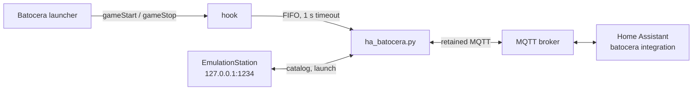

> **Before we start.** Batocera is a Linux distribution for retrogaming:
> you install it on a PC and it boots straight into EmulationStation, a
> menu you drive with a gamepad, with emulators for old consoles and home
> computers behind it. The games you see in the screenshots below are
> backup copies of originals I own. This post does not endorse downloading
> games, and nothing described here downloads any.

Under the TV in our living room there's **joker**, a mini PC with a Ryzen 7
8845HS running Batocera 43. It's the kids' console. It is now also a device
in Home Assistant, through an integration I wrote with Claude Code:
[ha-batocera](https://github.com/vjt/ha-batocera).

## Why

Three reasons, in the order they come up at home.

**Remote control, and search.** EmulationStation is fine for browsing on
the TV, but joker holds thousands of games, and searching them with a pad
means an on-screen keyboard and a d-pad, one letter at a time. On the
phone I type "mario" on a real keyboard, get every Mario on every system,
and one tap starts it on the TV.

**What the kids play, and for how long.** Home Assistant knows what is
running, since when, and how many minutes were played today. That's the
data you want before setting any limit, and the limits came after.

**Quitting a game from the phone.** Sometimes the exit hotkey on the pad
just doesn't respond. The stop button quits the game the way the hotkey
does, so saves get written, and if the game is still alive five seconds
later the daemon kills it.

## How it's built

There are two parts, and they live in the same repository:

- a Home Assistant **custom integration**;
- a small **daemon** that runs on the box (Python 3, standard library
  only), with a launch hook and a service script. It sits inside the
  integration's folder, so HACS ships it together with the integration.

Batocera runs every executable in `/userdata/system/scripts/` when a game
starts and when it stops, and the launcher waits for them. So the hook does
as little as possible: it writes the event into a FIFO, with a one-second
timeout, and exits. A hook that hangs can never delay a launch. It also
passes the launcher's pid, and the daemon checks every 15 seconds that the
launcher is still alive, so an emulator that crashes still ends the
session.

The daemon publishes everything as retained MQTT messages: state, game,
system, emulator, cover, start time, and a summary of the last session.
It talks to the broker through `mosquitto_pub` and `mosquitto_sub`, which
Batocera already ships, so there's nothing to install on the box beyond
the daemon itself. A `mosquitto_sub` that stays connected receives the
commands and holds the MQTT *will*: if the daemon or the network goes
away, the broker marks the box offline. The broker credentials live in
mosquitto config files with mode 600, never on a command line where `ps`
would show them.

In Home Assistant the box becomes a device with thirteen entities: a media
player (game, system, emulator, cover), today's playtime, a stop button, an
image of what the TV shows, and the limit settings.

## The catalog

EmulationStation has a web API on port 1234. The daemon reads the list of
games from it, on the box's loopback address only, and publishes it as one
retained message per system, gzip-compressed JSON, plus an index with a
hash for each system: a system is sent again only when its games change.
The catalog is read at startup, after each game (that system only), every
30 minutes while nobody plays, and on request. Only visible systems are
listed, hidden games never are, and when EmulationStation is in Kid mode,
only the games marked for kids.

Covers are not in the catalog. The page asks for them a few at a time, only
for the tiles on screen; the box scales them down to 256 pixels at the
lowest CPU priority, and Home Assistant keeps them for a week.

The box keeps its ROM paths to itself. A game's id is the first 12 hex
digits of the MD5 of its path, a launch request names a game by that id,
and the box launches only games from its own catalog.

A launch quits the running game first, waits for EmulationStation to be
idle, then asks it to start the new one as if it had been picked in its
menus. That's on purpose: the hook, the lock and the limits all see an
ordinary launch, and there is no side door.

The same catalog also shows up in Home Assistant's own media browser, and
automations can start a game with `media_player.play_media`.

## The page in the sidebar

The integration adds a **Batocera** page to the sidebar, with one tab per
box. It has a dark CRT look and a pixel font, because of course it does.

Below the bar with what's playing come the box's games: favourites,
recently played, then one tile per system, with the system's logo from the
EmulationStation theme. Inside a system, the ROM folders (MAME's genres,
for example) are tiles of their own.

The search box works at every level. From the top it searches every
system, inside a system it searches that system and its folders, and in
favourites or recently played it filters that list.

Recently played answers the first question, what actually gets played:

Tap a game and a sheet opens with **PRESS START**. If something is already
running, it says which game it is going to quit.

While a game runs, the bar at the top shows its cover, a preview of the
TV, the system, the time played, and the time left before the limit or the
end of the window, or FREE PLAY when nothing limits it. Under it there's
pause, offered when the emulator has a pause hotkey (this one doesn't,
hence NO PAUSE), and KILL. Kill takes two taps, because a game quit by
mistake loses whatever wasn't saved.

Everyone who can open Home Assistant sees the page and browses the games.
**Launching, pausing and stopping** take an admin, or a user picked in the
integration's options ("Who may play"); everyone else sees BROWSE ONLY. The
check lives in the services, not in the page, so it covers the media
player and the stop button everywhere in Home Assistant. Automations,
which run without a user, are allowed.

When the box is locked, the page says GAME OVER — LOCKED, with the reason
(locked by hand, outside play hours, no time left today), and PRESS START
is disabled. That's all the page does with limits: it shows them. Setting
them happens elsewhere, on purpose.

## The live screen

Every 15 seconds the daemon takes a screenshot from Batocera's Wayland
compositor with `grim`, scales it to a 640-pixel-wide JPEG with `ffmpeg`,
both at the lowest CPU priority, and publishes it only if the screen
changed. It's whatever the TV shows, menus included, and it's the small
preview in the bar.

Tap the preview and it opens as big as the page allows, and it goes live:
while someone watches, the box sends a 1280-pixel frame every second the
screen changes, and the page plays them as an MJPEG stream. Home Assistant
asks for 60 seconds of frames at a time and keeps renewing while anyone
has it open. When the last viewer closes it, or Home Assistant goes away,
the frames stop within a minute.

The live frames are not retained and go only to the open streams: no
entity changes, so the recorder never sees them. The 15-second screenshot
is a different matter. It's an ordinary image entity, and the recorder
keeps its history like any other unless you exclude it (the README shows
how). `screen_every=0` on the box turns screenshots off, and the live
screen with them.

## Limits

Batocera has no user profiles, so the limits apply to the whole box.
There are three:

- a **daily limit** in minutes, where 0 means none;
- a **time window** in which games are allowed: "allowed from" and
  "allowed until". When "until" is earlier than "from", the window spans
  midnight; when they're equal, there is no window;
- a **manual lock**, which holds until someone turns it off.

They're set on joker's device page in Home Assistant (Settings, Devices &
services, Batocera), not in the sidebar page. Since 0.5.4, changing them
takes an admin, whoever else may play: a user who is allowed to launch
games can't move the limits. Automations can, so different limits on
different days are just an automation that sets the entities at midnight.

Home Assistant decides, and the box obeys:

- Playtime is computed by the integration from the sessions the box
  reports, and it survives restarts. A session that runs across midnight
  counts for the new day only from midnight.
- Five minutes before the limit or the end of the window, the integration
  fires a `batocera_warning` event, once per game session. It's an event
  and not a notification, so you choose how to deliver it.
- At the limit, outside the window or under the manual lock, Home
  Assistant publishes a retained `lock` and sends `stop` to the running
  game, again every minute for as long as one keeps running.
- While the lock is on, the daemon stops any game as soon as it starts. It
  can't refuse the launch itself, because Batocera ignores the hook's exit
  code. Launches from Home Assistant are refused before they reach the
  box.

There are holes, and the README lists them. The warning doesn't show up
inside the game, only in Home Assistant. If the broker goes down, the
daemon keeps enforcing the last lock it received, but one that starts
while the broker is down starts unlocked, and Home Assistant can't stop a
game until the broker is back.

## The one warning

EmulationStation's web API, the same one the daemon uses, can be opened
to the whole network with its `PublicWebAccess` setting. Then port 1234
takes commands from anyone on the LAN, without authentication: launch or
quit games, send input. A game launched that way while the box is locked
still gets stopped, but only once it has started.

ha-batocera talks to that API from the box itself only, and never changes
the setting. But the daemon reports it, and while it's on, Home Assistant
shows a warning under **Settings, Repairs**, with the commands to restrict
the API to the box. The warning goes away by itself once the box reports
the setting off. The installer prints the same advice.

## Installing it

What you need:

- an **MQTT broker** the box can reach, with Home Assistant's MQTT
  integration connected to it;
- a Batocera release with `batocera-services` (user services in
  `/userdata/system/services`);
- **root SSH access** to the box, if you want Home Assistant to install the
  daemon for you (Batocera's default root password is `linux`);
- the integration, through **HACS**.

A request to list ha-batocera in HACS's default store is open
([hacs/default#14180](https://github.com/hacs/default/pull/14180)). Until
it's merged, it goes in as a custom repository: in HACS, three-dot menu,
Custom repositories, add `https://github.com/vjt/ha-batocera` with type
Integration, install "Batocera", and restart Home Assistant.

Then the daemon, from Home Assistant: Settings, Devices & services, Add
integration, Batocera, "Install ha-batocera on the box". It asks for a
name, the box's host, its root password, and the broker settings as the
box sees them. Home Assistant then:

- connects to the box over SSH as root, and trusts its host key from that
  first connection on;
- generates an ed25519 key pair of its own and adds the public key to
  root's `authorized_keys`;
- copies the daemon over and runs its installer, with the MQTT password on
  standard input, never on a command line.

The root password is used for that connection only and isn't stored. The
broker settings are asked for separately on purpose: Home Assistant's own
may point at `core-mosquitto` or `localhost`, which the box can't reach,
and its account usually has far more rights than a box needs. Give the box
an account of its own.

From then on Home Assistant keeps the daemon up to date. Each time the box
comes online, as soon as no game is running, it compares the version on
the box with its own and reinstalls if they differ. A game in progress is
never interrupted for an update. If something goes wrong, such as a failed
update or a box presenting a different SSH host key, it shows up in
Repairs.

If you'd rather not give Home Assistant root on the box, the README has a
one-line install with `get.sh`, and the setup has a "The box already runs
ha-batocera" option. Home Assistant doesn't update a box set up that way.

## How it was born

I wrote it with Claude Code, and all 73 commits carry its co-author line. I
said what I wanted, tried it on joker and on my phone, and sent back what
was wrong; Claude wrote the code and the tests.

It took two days of work, a week apart. The first commit is from 6
November: that afternoon brought the daemon, the integration and the
install over SSH (0.2.0), then the catalog, launching and a first version
of the page. The second day was 13 November: CI first, 0.3.0 at six in the
evening, and by 0.5.0, just before one in the morning, search everywhere,
system logos, ROM folders and the live screen. The next day added four
patch releases, up to 0.5.4. That's thirteen tagged releases in all.

CI runs three test suites on every push: the daemon's, standard library
only, on Python 3.12, which is what Batocera 43 ships; the integration's,
with pytest-homeassistant-custom-component and SSH faked, so nothing
connects anywhere; and the page's card, in jsdom. About two hundred tests
in all. Hassfest and the HACS validation action run on every push and
every night.

The last fix came from a screenshot. On the phone, the kill button's
"SURE?" was unreadable: a tapped button stays hovered on a touch screen,
and the hover style was beating the red one. In 0.5.4 it's a red bomb. The
same release closed [the only issue](https://github.com/vjt/ha-batocera/issues/1)
so far: until then, a user who was only allowed to play could raise the
limit or unlock the box.

Driving Batocera from the outside has its own pitfalls, and I hit enough
of them to write them down. The result is
[batocera-skill](https://github.com/vjt/batocera-skill), a Claude Code
skill to control a Batocera box over SSH: launch and stop games, drive
EmulationStation's menus without a gamepad, see what the TV shows, sort
out hotkeys and Bluetooth pads. It's a quick reference, the traps, and
small scripts that use only what stock Batocera ships. No ROMs, no
downloads, no daemon: the agent runs commands over SSH, and nothing stays
running.

Both are MIT-licensed.
