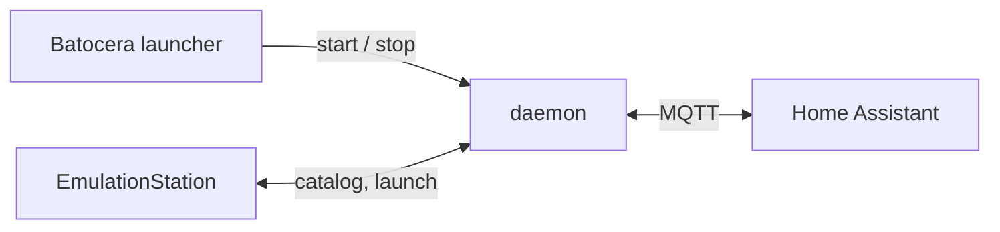

> **Before we start.** Batocera is a Linux distribution for retrogaming:
> it boots a PC straight into EmulationStation, a gamepad-driven menu with
> emulators for old consoles and home computers behind it. The games in the
> screenshots are backup copies of originals I own. This post does not
> endorse downloading games, and nothing described here downloads any.

Under our TV there's **joker**, a mini PC running Batocera 43: the kids'
console. Now it's also a device in Home Assistant, through an integration I
wrote with Claude Code: [ha-batocera](https://github.com/vjt/ha-batocera).

## Why

- **Search.** joker holds thousands of games, and searching them with a pad
  means an on-screen keyboard, one letter at a time. On the phone I type
  "mario", get every Mario on every system, and one tap starts it on the TV.
- **What the kids play, and for how long.** You want that data before
  setting any limit. The limits came after.
- **Quitting a stuck game.** Sometimes the exit hotkey just doesn't respond.
  The stop button on the phone always does.

## How it works

A small daemon on the box (Python, standard library only) hears about every
game start and stop from Batocera's launch hook, reads the catalog from
EmulationStation's local API, and talks to Home Assistant over MQTT. HACS
ships it together with the integration.

## The page

The integration adds a **Batocera** page to the sidebar: dark CRT look,
pixel font, because of course. Favourites, recently played, one tile per
system with its logo.

Search works at every level, across all systems or inside one.

Filters by genre, decade and rating, in one system or across all of them,
combine with the search. Every place says how many games it holds, a search
or the filters how many they found.

ROMs sorted into folders, by genre or anything else, are browsed as folders.

Recently played answers the first question, what actually gets played:

Tap a game and the sheet says what it is: year, genre, players, rating,
who made it, its description. **PRESS START**, and it runs on the TV. If
something is already running, the sheet says what it's about to quit.

While a game runs, the bar on top shows what's playing, for how long, and
how much time is left. KILL takes two taps, because a game quit by mistake
loses what wasn't saved.

Everyone can browse; launching and stopping take an admin or a user picked
in the options.

## The live screen

The preview in the bar is a screenshot of the TV, refreshed every 15
seconds. Tap it and it goes live, about a frame per second, for as long as
someone's watching.

## Limits

Three, for the whole box: a daily limit in minutes, a window of allowed
hours, and a manual lock. They're set on the device page, and only an admin
can change them. Five minutes before the end Home Assistant fires an event
you can turn into a notification; at the end it stops the game, and keeps
stopping any new one.

It's not a fortress, and the README says where the holes are.

## One warning

EmulationStation's web API can be opened to the whole LAN with its
`PublicWebAccess` setting, and then anyone on the network can launch games
or send input, no authentication. ha-batocera never opens it, and if it
finds it open, it says so under **Settings, Repairs**.

## Installing it

You need an MQTT broker the box can reach and root SSH on the box. Add the
repository to HACS as a custom one (the request for the default store is
[open](https://github.com/hacs/default/pull/14180)), install, then "Add
integration, Batocera": Home Assistant installs the daemon over SSH and
keeps it up to date, never in the middle of a game. Details in the
[README](https://github.com/vjt/ha-batocera).

## How it was born

Three days of work with Claude Code: I said what I wanted, tried it on
joker and on my phone, and sent back what was wrong. 0.2 to 0.7.1, sixteen
releases, close to three hundred tests.

Along the way I hit enough Batocera pitfalls to write them down:
[batocera-skill](https://github.com/vjt/batocera-skill), a Claude Code skill
to drive a Batocera box over SSH. No ROMs, no daemon, nothing left running.

Both MIT.
