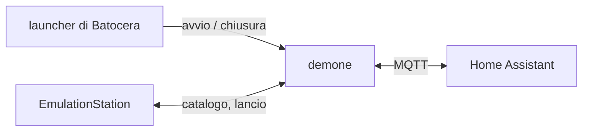

> **Prima di cominciare.** Batocera è una distribuzione Linux per il
> retrogaming: un PC si avvia direttamente in EmulationStation, un menu che
> si usa col joypad, con dietro gli emulatori delle vecchie console e dei
> vecchi home computer. I giochi negli screenshot sono copie di backup di
> originali miei. Questo post non incoraggia a scaricare giochi, e niente di
> quello che descrive ne scarica.

Sotto la TV c'è **joker**, un mini PC con Batocera 43: la console dei
bambini. Adesso è anche un dispositivo di Home Assistant, grazie a
un'integrazione che ho scritto con Claude Code:
[ha-batocera](https://github.com/vjt/ha-batocera).

## Perché

- **La ricerca.** Su joker ci sono migliaia di giochi, e cercarli col
  joypad vuol dire una tastiera a schermo, una lettera alla volta. Dal
  telefono scrivo "mario", vedo tutti i Mario di tutti i sistemi, e con un
  tocco parte sulla TV.
- **A cosa giocano i bambini, e per quanto.** Sono i dati che vuoi avere
  prima di mettere un limite. I limiti sono venuti dopo.
- **Chiudere un gioco piantato.** A volte la combinazione di uscita sul
  joypad non risponde. Il tasto stop sul telefono sì.

## Com'è fatto

Un piccolo demone sulla console (Python, solo libreria standard) viene
avvisato da Batocera a ogni avvio e chiusura di un gioco, legge il catalogo
dall'API locale di EmulationStation e parla con Home Assistant via MQTT.
HACS lo distribuisce insieme all'integrazione.

## La pagina

L'integrazione aggiunge una pagina **Batocera** nella barra laterale:
aspetto da CRT scuro, font pixel, ovviamente. Preferiti, giocati di
recente, una tessera per sistema col suo logo.

La ricerca funziona a ogni livello, su tutti i sistemi o dentro uno solo.
Cerca anche in quello che dicono le descrizioni dei giochi: quelli vengono
dopo i risultati per nome, sotto IN THE DESCRIPTION.

I filtri per genere, decennio e voto, dentro un sistema o su tutti, si
combinano con la ricerca. Ogni livello dice quanti giochi contiene, la
ricerca o i filtri quanti ne hanno trovati.

Le ROM divise in cartelle, per genere o come ti pare, si sfogliano come
cartelle.

I giocati di recente rispondono alla prima domanda, a cosa si gioca
davvero:

Tocchi un gioco e la scheda dice cos'è: anno, genere, giocatori, voto,
chi l'ha fatto, la descrizione. **PRESS START**, e parte sulla TV. Se ce
n'è già uno aperto, la scheda dice quale sta per chiudere.

Mentre si gioca, la barra in alto mostra cosa, da quanto, e quanto tempo
resta. KILL vuole due tocchi, perché un gioco chiuso per sbaglio perde
quello che non era salvato.

Sfogliare possono tutti; lanciare e fermare, solo un admin o un utente
scelto nelle opzioni.

## Lo schermo in diretta

L'anteprima nella barra è uno screenshot della TV, aggiornato ogni 15
secondi. La tocchi e va in diretta, più o meno un fotogramma al secondo,
finché qualcuno guarda.

## Spegnere e accendere

SHUT DOWN spegne la console come fa il menu di EmulationStation, quindi le
liste dei giochi vengono salvate, dopo aver chiuso il gioco come fa lo
stop. A console spenta la pagina lo dice, e i giochi restano lì da
sfogliare. POWER ON la sveglia dalla rete, senza indirizzi MAC da scrivere:
è la console stessa, finché è accesa, a dire a Home Assistant come
svegliarla.

## I limiti

Tre, per tutta la console: un limite giornaliero in minuti, una fascia di
orari consentiti e un blocco manuale. Si impostano dalla pagina del
dispositivo, e solo un admin li può cambiare. Cinque minuti prima della
fine Home Assistant lancia un evento che puoi trasformare in una notifica;
alla fine ferma il gioco, e continua a fermare quelli nuovi.

Non è una fortezza, e il README dice dove sono i buchi.

## Un avvertimento

L'API web di EmulationStation si può aprire a tutta la rete con
l'impostazione `PublicWebAccess`, e a quel punto chiunque in LAN può
lanciare giochi o mandare input, senza autenticazione. ha-batocera non la
apre mai, e se la trova aperta lo dice in **Impostazioni, Riparazioni**.

## Installarlo

Serve un broker MQTT raggiungibile dalla console e l'accesso SSH di root
alla console. Aggiungi il repository a HACS come repository personalizzato
(la richiesta per lo store di default è
[aperta](https://github.com/hacs/default/pull/14180)), installa, poi
"Aggiungi integrazione, Batocera": Home Assistant installa il demone via
SSH e lo tiene aggiornato, mai a partita in corso. I dettagli sono nel
[README](https://github.com/vjt/ha-batocera).

## Com'è nato

Tre giornate di lavoro con Claude Code: io dicevo cosa volevo, provavo su
joker e sul telefono, e rimandavo indietro quello che non andava. Dalla
0.2 alla 0.9.1, diciannove release, quasi trecento test.

Strada facendo ho preso abbastanza trappole di Batocera da metterle per
iscritto: [batocera-skill](https://github.com/vjt/batocera-skill), una skill
di Claude Code per pilotare una console Batocera via SSH. Niente ROM,
niente demoni, niente che resti acceso.

Licenza MIT per entrambi.
