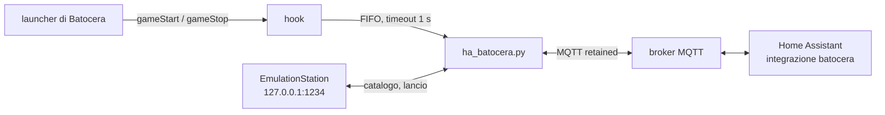

> **Prima di cominciare.** Batocera è una distribuzione Linux per il
> retrogaming: la installi su un PC e all'avvio ti trovi direttamente in
> EmulationStation, un menu che si usa col joypad, con dietro gli emulatori
> delle vecchie console e dei vecchi home computer. I giochi che si vedono
> negli screenshot qui sotto sono copie di backup di originali miei. Questo
> post non incoraggia a scaricare giochi, e niente di quello che descrive ne
> scarica.

Sotto la TV del salotto c'è **joker**, un mini PC con un Ryzen 7 8845HS che
fa girare Batocera 43. È la console dei bambini. Adesso è anche un
dispositivo di Home Assistant, grazie a un'integrazione che ho scritto con
Claude Code: [ha-batocera](https://github.com/vjt/ha-batocera).

## Perché

I motivi sono tre, nell'ordine in cui saltano fuori in casa.

**Telecomando e ricerca.** Sulla TV EmulationStation va benissimo per
sfogliare, ma su joker ci sono migliaia di giochi, e cercarli col joypad
vuol dire una tastiera a schermo e la croce direzionale, una lettera alla
volta. Dal telefono scrivo "mario" con una tastiera vera, mi escono tutti i
Mario di tutti i sistemi, e con un tocco parte sulla TV.

**A cosa giocano i bambini, e quanto.** Home Assistant sa cosa sta
girando, da quando, e quanti minuti si sono giocati oggi. Sono i dati che
ti servono prima di mettere qualunque limite, e infatti i limiti sono
venuti dopo.

**Chiudere un gioco dal telefono.** A volte la combinazione per uscire dal
gioco sul joypad non risponde e basta. Il pulsante di stop chiude il gioco
come farebbe la combinazione, quindi i salvataggi vengono scritti, e se
cinque secondi dopo il gioco è ancora vivo il daemon lo ammazza.

## Com'è fatto

I pezzi sono due, e stanno nello stesso repository:

- un'**integrazione custom** di Home Assistant;
- un piccolo **daemon** che gira sulla console (Python 3, solo libreria
  standard), con un hook di lancio e uno script di servizio. Sta dentro la
  cartella dell'integrazione, così HACS lo distribuisce insieme a lei.

Batocera esegue tutto quello che trova in `/userdata/system/scripts/`
quando un gioco parte e quando finisce, e il launcher aspetta che abbiano
finito. Quindi l'hook fa il meno possibile: scrive l'evento in una FIFO,
con un timeout di un secondo, ed esce. Un hook che si pianta non può mai
ritardare un lancio. Passa anche il pid del launcher, e il daemon controlla
ogni 15 secondi che sia ancora vivo: se un emulatore crasha, la sessione
si chiude lo stesso.

Il daemon pubblica tutto come messaggi MQTT retained: stato, gioco,
sistema, emulatore, copertina, ora di inizio e un riassunto dell'ultima
sessione. Col broker parla attraverso `mosquitto_pub` e `mosquitto_sub`,
che Batocera ha già di serie, quindi sulla console non c'è niente da
installare oltre al daemon. Un `mosquitto_sub` sempre connesso riceve i
comandi e tiene il *will* MQTT: se il daemon o la rete spariscono, il
broker segna la console come offline. Le credenziali del broker stanno in
file di configurazione di mosquitto con permessi 600, mai su una riga di
comando dove `ps` le farebbe vedere a tutti.

In Home Assistant la console diventa un dispositivo con tredici entità: un
media player (gioco, sistema, emulatore, copertina), il tempo di gioco di
oggi, un pulsante di stop, un'immagine di quello che mostra la TV, e le
impostazioni dei limiti.

## Il catalogo

EmulationStation ha un'API web sulla porta 1234. Il daemon ci legge
l'elenco dei giochi, solo sull'indirizzo di loopback della console, e lo
pubblica come un messaggio retained per sistema, JSON compresso con gzip,
più un indice con un hash per ogni sistema: un sistema viene rimandato
solo quando cambiano i suoi giochi. Il catalogo si rilegge all'avvio, dopo
ogni partita (solo quel sistema), ogni 30 minuti quando nessuno gioca, e a
richiesta. Ci finiscono solo i sistemi visibili, mai i giochi nascosti, e
se EmulationStation è in modalità Kid, solo i giochi marcati per bambini.

Le copertine nel catalogo non ci sono. La pagina le chiede poche alla
volta, solo per le caselle che si vedono; la console le rimpicciolisce a
256 pixel con la priorità di CPU più bassa, e Home Assistant le tiene per
una settimana.

I percorsi delle ROM restano sulla console. L'id di un gioco sono le prime
12 cifre esadecimali dell'MD5 del suo percorso, una richiesta di lancio
nomina il gioco con quell'id, e la console lancia solo giochi del suo
catalogo.

Un lancio prima chiude il gioco in corso, aspetta che EmulationStation sia
libero, e poi gli chiede di far partire quello nuovo come se l'avessi
scelto dai suoi menu. È voluto: l'hook, il blocco e i limiti vedono un
lancio normale, e porte di servizio non ce ne sono.

Lo stesso catalogo compare anche nel media browser di Home Assistant, e
dalle automazioni un gioco si lancia con `media_player.play_media`.

## La pagina nella barra laterale

L'integrazione aggiunge una pagina **Batocera** alla barra laterale, con
una scheda per ogni console. Ha un look da CRT scuro e un font pixel,
perché come poteva essere altrimenti.

Sotto la barra con quello che sta girando ci sono i giochi: preferiti,
giocati di recente, poi una casella per sistema, col logo preso dal tema di
EmulationStation. Dentro un sistema, le cartelle delle ROM (per esempio i
generi di MAME) diventano caselle a loro volta.

La ricerca funziona a ogni livello. Dall'inizio cerca in tutti i sistemi,
dentro un sistema cerca in quel sistema e nelle sue cartelle, e nei
preferiti o nei giocati di recente filtra quella lista.

I giocati di recente rispondono alla prima domanda, cioè a cosa si gioca
davvero:

Tocchi un gioco e si apre una scheda con **PRESS START**. Se c'è già
qualcosa in corso, ti dice quale gioco sta per chiudere.

Mentre un gioco gira, la barra in alto mostra la copertina, un'anteprima
della TV, il sistema, il tempo giocato, e quanto manca al limite o alla
fine della fascia oraria, oppure FREE PLAY quando non c'è limite. Sotto c'è
la pausa, se l'emulatore ha una combinazione per metterla (questo no,
quindi NO PAUSE), e KILL. Il kill vuole due tocchi, perché un gioco chiuso
per sbaglio perde tutto quello che non era salvato.

Chiunque possa aprire Home Assistant vede la pagina e sfoglia i giochi.
**Lanciare, mettere in pausa e chiudere** i giochi invece tocca a un admin,
o a un utente scelto nelle opzioni dell'integrazione ("Who may play"); gli
altri vedono BROWSE ONLY. Il controllo sta nei servizi, non nella pagina,
quindi vale per il media player e per il pulsante di stop ovunque in Home
Assistant. Le automazioni, che girano senza utente, possono.

Quando la console è bloccata la pagina dice GAME OVER — LOCKED, col
motivo (bloccata a mano, fuori orario, tempo di oggi finito), e PRESS
START è disattivato. Coi limiti la pagina non fa altro: li mostra. Si
impostano da un'altra parte, apposta.

## Lo schermo in diretta

Ogni 15 secondi il daemon fa uno screenshot dal compositor Wayland di
Batocera con `grim`, lo rimpicciolisce a un JPEG largo 640 pixel con
`ffmpeg`, tutti e due con la priorità di CPU più bassa, e lo pubblica solo
se lo schermo è cambiato. È quello che mostra la TV, menu compresi, ed è
l'anteprima piccola nella barra.

Se tocchi l'anteprima si apre grande quanto la pagina, e va in diretta:
mentre qualcuno guarda, la console manda un fotogramma largo 1280 pixel
ogni secondo in cui lo schermo cambia, e la pagina li fa vedere come uno
stream MJPEG. Home Assistant chiede 60 secondi di fotogrammi alla volta e
continua a rinnovare finché qualcuno ce l'ha aperto. Quando l'ultimo lo
chiude, o Home Assistant sparisce, i fotogrammi si fermano entro un
minuto.

I fotogrammi della diretta non sono retained e vanno solo agli stream
aperti: nessuna entità cambia, quindi il recorder non li vede mai. Lo
screenshot ogni 15 secondi è un'altra storia: è una normale entità
immagine, e il recorder ne tiene la storia come per tutte le altre, a meno
che tu non la escluda (il README spiega come). Con `screen_every=0` sulla
console gli screenshot si spengono, e la diretta con loro.

## I limiti

Batocera non ha profili utente, quindi i limiti valgono per tutta la
console. Sono tre:

- un **limite giornaliero** in minuti, dove 0 vuol dire nessun limite;
- una **fascia oraria** in cui si può giocare: "allowed from" e "allowed
  until". Se "until" viene prima di "from" la fascia scavalca la
  mezzanotte; se sono uguali, la fascia non c'è;
- un **blocco manuale**, che resta finché qualcuno non lo toglie.

Si impostano dalla pagina del dispositivo joker in Home Assistant
(Impostazioni, Dispositivi e servizi, Batocera), non dalla pagina nella
barra laterale. Dalla 0.5.4 per cambiarli serve un admin, chiunque altro
possa giocare: un utente che può lanciare i giochi non può spostarsi i
limiti. Le automazioni sì, quindi limiti diversi a seconda del giorno sono
solo un'automazione che a mezzanotte imposta le entità.

Decide Home Assistant, la console obbedisce:

- Il tempo di gioco lo calcola l'integrazione dalle sessioni che manda la
  console, e sopravvive ai riavvii. Una sessione a cavallo della
  mezzanotte conta per il giorno nuovo solo dalla mezzanotte in poi.
- Cinque minuti prima del limite o della fine della fascia, l'integrazione
  lancia un evento `batocera_warning`, una volta per partita. È un evento
  e non una notifica, così decidi tu come farlo arrivare.
- Al limite, fuori fascia o col blocco manuale, Home Assistant pubblica un
  `lock` retained e manda `stop` al gioco in corso, e lo rimanda ogni
  minuto finché un gioco continua a girare.
- Col blocco attivo, il daemon chiude qualsiasi gioco appena parte. Il
  lancio in sé non lo può rifiutare, perché Batocera ignora il codice di
  uscita dell'hook. I lanci da Home Assistant vengono rifiutati prima di
  arrivare alla console.

I buchi ci sono, e il README li elenca. L'avviso non compare dentro il
gioco, solo in Home Assistant. Se il broker cade, il daemon continua a far
rispettare l'ultimo blocco che ha ricevuto, ma uno che parte col broker
giù parte sbloccato, e finché il broker non torna Home Assistant non può
fermare nessun gioco.

## L'unico avvertimento

L'API web di EmulationStation, la stessa che usa il daemon, si può aprire
a tutta la rete con l'impostazione `PublicWebAccess`. A quel punto la porta
1234 accetta comandi da chiunque sia in LAN, senza autenticazione: lanciare
o chiudere giochi, mandare input. Un gioco lanciato così a console bloccata
viene fermato lo stesso, ma solo dopo che è partito.

ha-batocera usa quell'API solo dalla console stessa, e l'impostazione non
la tocca mai. Però il daemon la segnala, e finché è accesa Home Assistant
mostra un avviso in **Impostazioni, Riparazioni**, coi comandi per
limitare l'API alla console. L'avviso sparisce da solo quando la console
segnala l'impostazione spenta. L'installer stampa lo stesso consiglio.

## Installazione

Cosa serve:

- un **broker MQTT** raggiungibile dalla console, con l'integrazione MQTT
  di Home Assistant collegata;
- una versione di Batocera con `batocera-services` (i servizi utente in
  `/userdata/system/services`);
- l'**accesso SSH da root** alla console, se vuoi che il daemon lo installi
  Home Assistant (la password di root di default di Batocera è `linux`);
- l'integrazione, tramite **HACS**.

La richiesta per avere ha-batocera nello store di default di HACS è aperta
([hacs/default#14180](https://github.com/hacs/default/pull/14180)). Finché
non viene accettata, si aggiunge come repository custom: in HACS, menu coi
tre puntini, Custom repositories, aggiungi
`https://github.com/vjt/ha-batocera` di tipo Integration, installi
"Batocera" e riavvii Home Assistant.

Poi il daemon, da Home Assistant: Impostazioni, Dispositivi e servizi,
Aggiungi integrazione, Batocera, "Install ha-batocera on the box". Ti
chiede un nome, l'host della console, la sua password di root e le
impostazioni del broker come le vede la console. A quel punto Home
Assistant:

- si collega alla console in SSH come root, e da quella prima connessione
  in poi si fida della sua chiave host;
- genera una coppia di chiavi ed25519 sua e aggiunge la chiave pubblica
  agli `authorized_keys` di root;
- copia il daemon e lancia l'installer, con la password MQTT sullo
  standard input, mai su una riga di comando.

La password di root serve solo per quella connessione e non viene salvata.
Le impostazioni del broker vengono chieste a parte apposta: quelle di Home
Assistant possono puntare a `core-mosquitto` o `localhost`, che dalla
console non si raggiungono, e il suo account di solito ha molti più
permessi di quanti ne servano a una console. Dagliene uno suo.

Da lì in poi il daemon lo tiene aggiornato Home Assistant. Ogni volta che
la console torna online, appena nessuno sta giocando, confronta la versione
sulla console con la sua e reinstalla se sono diverse. Una partita in
corso non viene mai interrotta per un aggiornamento. Se qualcosa va storto,
per esempio un aggiornamento fallito o una console che presenta una chiave
SSH diversa, lo trovi in Riparazioni.

Se preferisci non dare a Home Assistant l'accesso da root alla console, nel
README c'è un'installazione in una riga con `get.sh`, e nella
configurazione c'è l'opzione "The box already runs ha-batocera". Una
console configurata così Home Assistant non la aggiorna.

## Com'è nato

L'ho scritto con Claude Code, e tutti i 73 commit hanno la sua riga di
co-autore. Io dicevo cosa volevo, lo provavo su joker e sul telefono, e
rimandavo indietro quello che non andava; il codice e i test li ha scritti
Claude.

Ci sono voluti due giorni di lavoro, a una settimana di distanza. Il primo
commit è del 6 novembre: quel pomeriggio sono arrivati il daemon,
l'integrazione e l'installazione via SSH (0.2.0), poi il catalogo, i
lanci e una prima versione della pagina. Il secondo giorno è stato il 13
novembre: prima la CI, la 0.3.0 alle sei di sera, e con la 0.5.0, poco
prima dell'una di notte, la ricerca ovunque, i loghi dei sistemi, le
cartelle delle ROM e lo schermo in diretta. Il giorno dopo sono arrivate
altre quattro release di correzioni, fino alla 0.5.4. In tutto, tredici
release con il loro tag.

La CI fa girare tre suite di test a ogni push: quella del daemon, solo
libreria standard, su Python 3.12, che è quello di Batocera 43; quella
dell'integrazione, con pytest-homeassistant-custom-component e l'SSH
finto, così non si collega da nessuna parte; e quella della card della
pagina, in jsdom. Circa duecento test in tutto. Hassfest e l'action di
validazione di HACS girano a ogni push e ogni notte.

L'ultima correzione è nata da uno screenshot. Sul telefono il "SURE?" del
pulsante kill non si leggeva: su uno schermo touch il pulsante toccato
resta in stato hover, e lo stile dell'hover vinceva su quello rosso. Nella
0.5.4 è una bomba rossa. La stessa release ha chiuso
[l'unica issue](https://github.com/vjt/ha-batocera/issues/1) ricevuta finora:
fino ad allora, un utente che poteva solo giocare poteva anche alzarsi il
limite o sbloccare la console.

Pilotare Batocera da fuori ha le sue trappole, e ne ho prese abbastanza da
volerle mettere per iscritto. Il risultato è
[batocera-skill](https://github.com/vjt/batocera-skill), una skill di
Claude Code per controllare una console Batocera via SSH: lanciare e
chiudere giochi, muoversi nei menu di EmulationStation senza joypad,
vedere cosa mostra la TV, sistemare le combinazioni di tasti e i joypad
Bluetooth. Dentro ci sono un riferimento rapido, le trappole, e qualche
script che usa solo quello che Batocera ha di serie. Niente ROM, niente
download, niente daemon: l'agente lancia comandi via SSH, e non resta
niente acceso.

Sono tutti e due sotto licenza MIT.
